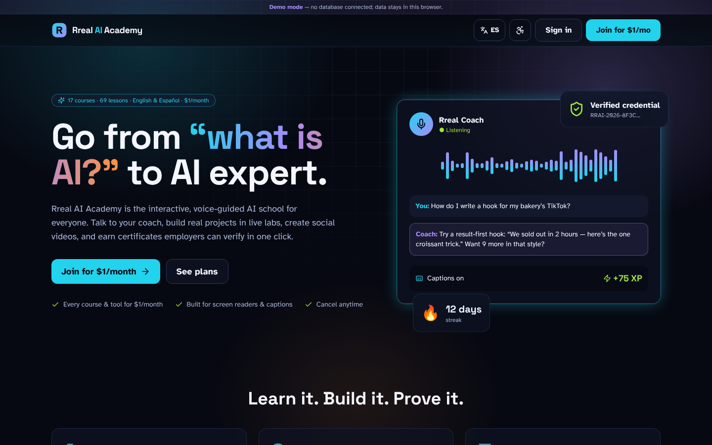
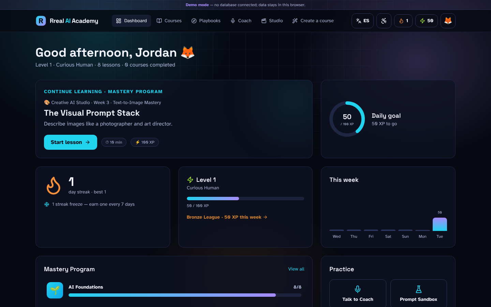
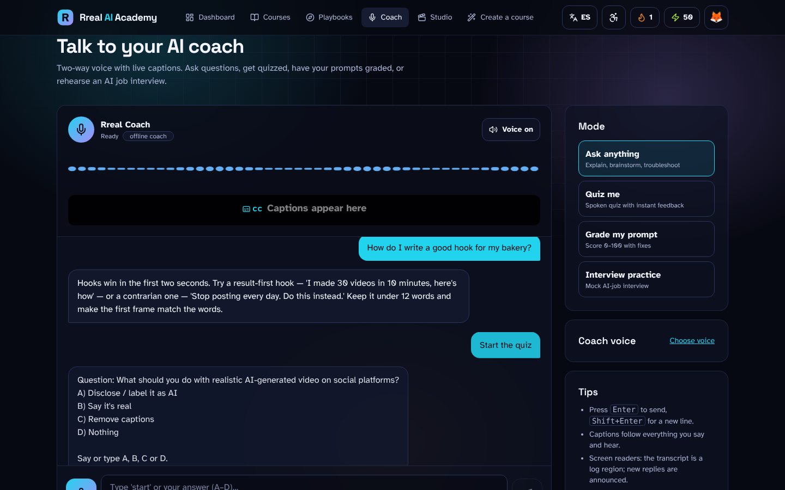
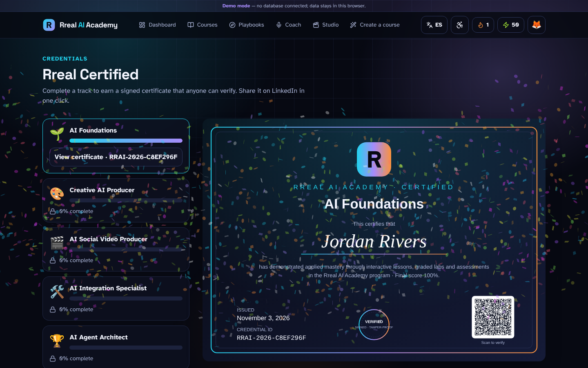

# Rreal AI Academy

**From “what is AI?” to AI expert.** An interactive, voice-guided, fully accessible, subscription AI academy.

**$1/month** · English & Español · 8-week Mastery Program + 12 standalone courses (Dummy → Expert) · 12 step-by-step Playbooks ·
AI Course Creator (ask for any course) · voice coach with 12 selectable voices · real AI video rendering · social account connections ·
plugins · XP, streaks, leagues and badges · signed, verifiable certificates (Rreal-issued or accredited) with one-click LinkedIn.

**Going live? Follow [docs/LAUNCH.md](docs/LAUNCH.md).**



| Dashboard | Rreal Coach (voice + captions) | Verifiable certificate |
|---|---|---|
|  |  |  |

## Run it in 60 seconds (no accounts or keys needed)
```bash
npm install
npm run dev          # http://localhost:3000
```
With no environment variables the app runs in **Demo mode**: sign up, learn, earn badges, start a trial and claim certificates.
Everything is saved in your browser. Add keys one at a time to switch on real services.

## Feature tour
| Area | What it does |
|---|---|
| **Accounts** | Sign up, sign in with email *or* username, sign out, **Forgot Password** (secure one-time email link), **Forgot Username** (emailed to the address on file), password strength meter |
| **Onboarding** | Goal, placement (start at any track), daily goal, accessibility setup |
| **Curriculum** | Track → Week → Module → Lesson → interactive steps (reading, examples, quizzes, prompt labs, reflections). Gated by subscription + prerequisites |
| **Rreal Coach** | Mic input with a live audio waveform, synchronized captions, spoken replies (ElevenLabs or browser voice). Modes: Ask anything, Quiz me, Grade my prompt, Interview practice |
| **Prompt Sandbox** | Live Prompt Quality Score (0–100) with a per-criterion checklist; run prompts against Claude (or the offline simulator) and get a coach critique |
| **Social Video Studio** | Concept → hook generator → editable scene script → animated 9:16 captioned preview with AI-disclosure label → posting schedule exported to your calendar (.ics) |
| **Gamification** | XP + streak multiplier, levels and titles, daily goal ring, streak freezes, streak-at-risk alert, weekly leagues, 19 badges with 3D unlock animations and confetti |
| **Daily Review** | Spaced-repetition quiz drawn from what you've completed |
| **Portfolio** | Every passed lab and Studio project saved as proof of skill |
| **Certificates** | Tamper-proof HMAC-signed credentials, high-res SVG/PDF with QR code, public `/verify/[token]` page for employers, LinkedIn “Add to profile” |
| **Billing** | Stripe Checkout with a 7-day trial, Customer Portal, signed and idempotent webhooks |
| **Accessibility** | Screen-reader landmarks and live regions, full keyboard support, captions everywhere, visual alerts for sounds, read-aloud with word highlighting, high contrast, text up to 150%, reduced motion, dyslexia-friendly spacing, low-vision typeface |

## Going to production
1. **Supabase**: create a project. Run `supabase/migrations/0001_init.sql`, then `supabase/seed.sql`, in the SQL editor (or `supabase db push`).
   In Auth → URL configuration, set the Site URL and add `https://YOUR_DOMAIN/reset-password` and `/onboarding` as redirect URLs.
   In Auth → SMTP, plug in Resend so emails come from your domain.
2. **Environment**: copy `.env.example` → `.env.local` (or set the same variables in Vercel). At minimum set the Supabase keys, `CERT_SIGNING_SECRET` (`openssl rand -base64 48`) and `NEXT_PUBLIC_SITE_URL`.
3. **Stripe**: create a “Pro” product with monthly and annual prices, then put the price IDs in `STRIPE_PRICE_MONTHLY` / `STRIPE_PRICE_ANNUAL`.
   Add a webhook to `https://YOUR_DOMAIN/api/webhooks/stripe` for `checkout.session.completed` and `customer.subscription.*`.
   Enable the Customer Portal.
4. **AI**: set `ANTHROPIC_API_KEY` (live Coach and Sandbox). Optionally set `ELEVENLABS_API_KEY` + `ELEVENLABS_VOICE_ID` for a premium coach voice.
5. **Deploy**: push to GitHub and import into Vercel (zero config). Check `https://YOUR_DOMAIN/api/health` to see which integrations are live.

## Quality checks
```bash
npm run typecheck && npm run lint && npm test           # 29 unit tests
npm run build && npm start &                             # then:
BASE=http://localhost:3000 node tests/e2e/smoke.mjs      # 48 end-to-end + accessibility checks, refreshes docs/screenshots
```
The database layer was also tested against Postgres 16: RLS blocks XP tampering, forged certificates and email harvesting, and the streak, freeze, gating and exam rules behave as specified.

## Docs
- `CLAUDE.md`: architecture and rules for anyone (human or AI) working on the code
- `docs/PRODUCT_BLUEPRINT.md`: market analysis, what was built, what was added beyond the original brief, and the roadmap
- `docs/QUESTIONS_FOR_GOOGLE_AGENT.md`: open decisions for the owner and advisors
